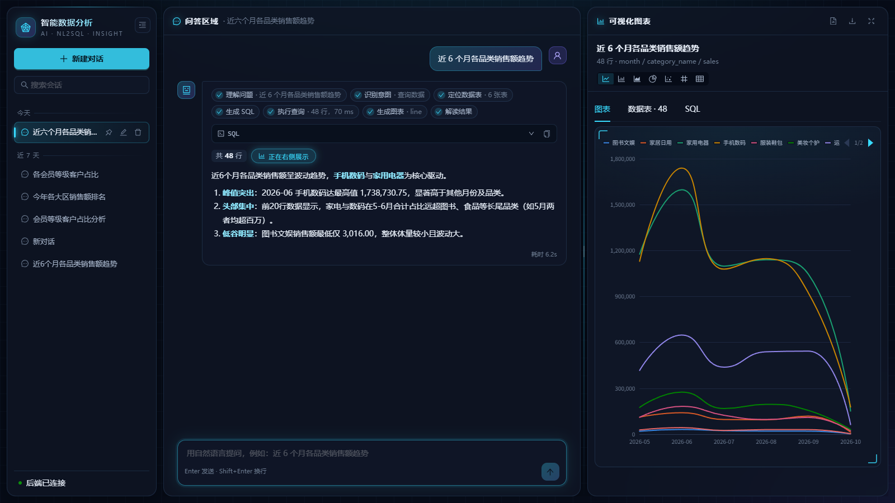
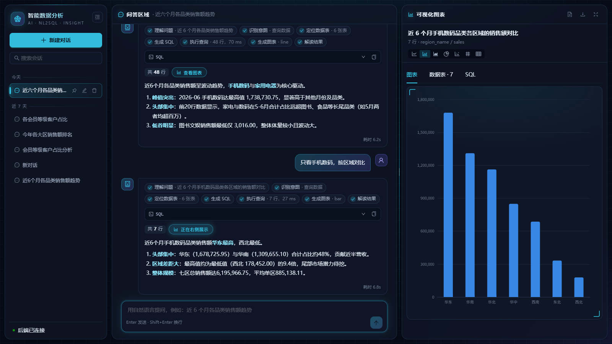
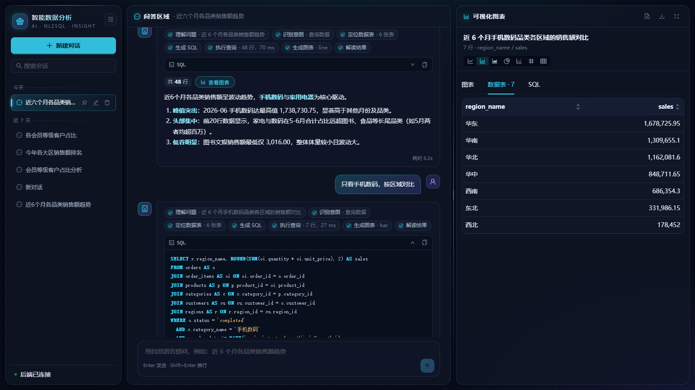
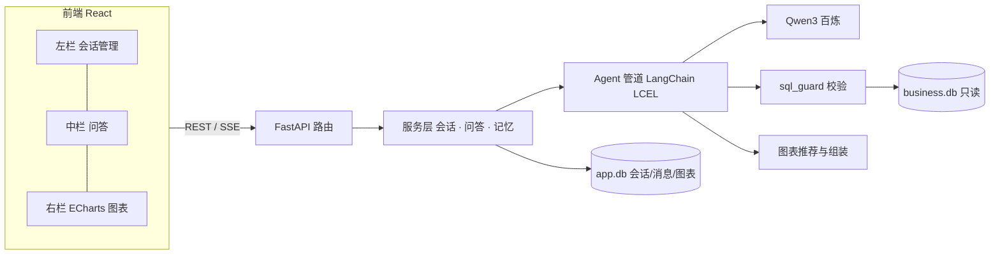

# NL2SQL ChatBI · 智能数据分析系统

用自然语言提问，系统自动生成 SQL、查询数据库，并在前端实时渲染图表和文字解读，支持多轮追问。

后端：FastAPI + LangChain + 阿里云百炼 Qwen3 + SQLite。前端：React + TypeScript + Ant Design + ECharts。



> 这个项目用 Vibe Coding 的方式完成：人负责需求、决策和验收，AI 编程助手负责调研、设计、实现和测试。完整过程见 [docs/VIBE_CODING.md](docs/VIBE_CODING.md)。

## 功能

- **自然语言查数**：问“近 6 个月各品类销售额趋势”，自动生成并执行 SQL。SQL 报错时，系统会带着错误信息让模型重写，最多 3 次。
- **实时渲染**：通过 SSE 流式推送。处理步骤、SQL、数据、图表、解读依次出现，首个事件约 100 ms，平均 3 秒出图。
- **自动选图**：可以生成折线、柱状、堆叠柱、饼图、散点、指标卡、表格。由规则自动推荐，也可以手动切换，切换结果会保存。
- **多轮追问**：“只看手机数码，按区域对比”会被改写成完整的问题。系统能区分追问和新问题，新问题不会套用上一轮的条件。
- **会话管理**：新建、搜索、置顶、重命名、删除，按“今天 / 近 7 天 / 更早”分组，刷新页面后能恢复。
- **安全**：业务库以只读方式打开，加上 SQL 语法树校验（只允许单条 SELECT、表白名单、强制 LIMIT）。“删除所有订单”这类请求不会被执行。
- **结果可导出**：图表导出 PNG，数据导出 CSV，支持全屏查看。

| 追问后自动换图 | 数据表与 SQL |
|---|---|
|  |  |

## 架构



一次问答经过的步骤：

```
问题改写 → 意图识别 → 准备表结构 → 生成 SQL → 安全校验 → 只读执行 →（出错重写，最多 3 次）→ 推荐图表 → 流式解读
```

设计原则：**LLM 只负责“想”，代码负责“做”**。模型只输出 SQL 和图表类型，SQL 的校验、执行和 ECharts 配置的组装都由确定性代码完成。明细数据不回传给模型，模型只看到统计摘要。

详细设计见 [docs/DESIGN.md](docs/DESIGN.md)，包括模块划分、数据库表、接口和 SSE 事件定义、各阶段的验收记录。

## 技术栈

| 层 | 选型 |
|---|---|
| 大模型 | 阿里云百炼 Qwen3（`qwen3.8-max` 生成 SQL，`qwen3.8-flash` 负责改写、意图识别和解读），通过 OpenAI 兼容接口调用 |
| 后端 | Python 3.12+、FastAPI、LangChain 1.x、sse-starlette、sqlglot、pydantic-settings |
| 数据库 | SQLite3：`business.db` 存电商示例数据（只读），`app.db` 存会话、消息和图表 |
| 前端 | React 19、TypeScript、Vite 8、Ant Design 6、ECharts 6、Zustand、fetch-event-source |
| 测试 | pytest（假 LLM，不消耗 Token）、Vitest + Testing Library、Puppeteer 端到端测试 |

## 快速开始

需要 Python 3.12+、Node.js 20+，以及阿里云百炼的 API Key。

```bash
# 1. 后端
cd backend
python -m venv .venv
.venv\Scripts\activate            # macOS / Linux：source .venv/bin/activate
pip install -r requirements.txt
cp .env.example .env              # 填写 DASHSCOPE_API_KEY
python scripts/seed_business_db.py   # 生成示例业务库（2 万订单、24 个月）
python scripts/check_llm.py          # 确认模型能调通
uvicorn app.main:app --port 8000

# 2. 前端（另开一个终端）
cd frontend
npm install
npm run dev                       # http://localhost:3000，/api 会代理到 8000
```

Windows 用户装好依赖后，可以直接双击根目录的 `启动.bat`。它会打开前端和后端两个窗口，然后自动打开浏览器。

**不启动后端也能看界面**：在 `frontend/.env.local` 里写入 `VITE_USE_MOCK=true`，再运行 `npm run dev`，页面会使用内置的模拟数据。

> 国内网络安装依赖较慢时，可以加镜像：`pip install -i https://mirrors.aliyun.com/pypi/simple/ ...`，`npm install --registry=https://registry.npmmirror.com`。

## 示例问题

- 近 6 个月各品类销售额趋势 → 多系列折线图
- 只看手机数码，按区域对比（追问）→ 柱状图
- 各会员等级的客户占比 → 饼图
- 上个月的总销售额是多少 → 指标卡
- 删除所有订单 → 拒绝执行

## 测试

| 类型 | 命令 | 结果 |
|---|---|---|
| 后端单元 / 接口测试 | `cd backend && pytest` | 134 个测试通过，使用假 LLM，不消耗 Token |
| 前端单元 / 组件 / 流程测试 | `cd frontend && npm run test -- --run` | 44 个测试通过，使用 Mock |
| 前后端接口字段核对 | `cd frontend && node scripts/check-contract.mjs` | 11 个模型、9 种 SSE 事件一致 |
| 端到端联调 | `cd frontend && node e2e/run-e2e.mjs` | 10/10 通过：真实浏览器 + 真实后端 + 真实模型 |
| SQL 准确率评测 | `cd backend && python tests/eval/run_eval.py` | 执行准确率（EX）81%～86%（21 条示例） |

端到端测试需要本机安装 Chrome。测试工具 puppeteer-core 没有放进项目依赖，按 [run-e2e.mjs](frontend/e2e/run-e2e.mjs) 开头的说明临时安装即可。端到端测试和准确率评测会调用真实模型、消耗 Token。

## 目录结构

```
├─ backend/
│  ├─ app/
│  │  ├─ api/          # 路由：sessions / chat(SSE) / charts / schema / health
│  │  ├─ services/     # 会话、问答编排、图表服务
│  │  ├─ agent/        # NL2SQL 管道与全部 Prompt
│  │  ├─ chart/        # 结果画像 → 图表推荐 → ECharts option（纯函数）
│  │  ├─ memory/       # 滑动窗口 + 摘要压缩的上下文记忆
│  │  ├─ db/           # 只读执行、Schema 抽取、app.db 建表
│  │  ├─ repository/   # app.db 读写
│  │  ├─ llm/          # Qwen3 客户端
│  │  └─ sql_guard.py  # SQL 安全校验
│  ├─ semantic/        # 数据字典、示例问题集
│  ├─ scripts/         # 生成示例库、检查模型、命令行调试
│  └─ tests/           # 单元测试、接口测试、eval/ 准确率评测
├─ frontend/
│  ├─ src/
│  │  ├─ components/   # sidebar / chat / chart 三栏组件
│  │  ├─ stores/       # Zustand：会话、消息、图表
│  │  ├─ services/     # REST + SSE；mocks/ 提供同签名的 Mock
│  │  ├─ theme/        # 深色科技风主题、图表样式
│  │  └─ types/        # 与后端一一对应的接口类型
│  ├─ scripts/check-contract.mjs
│  └─ e2e/run-e2e.mjs
├─ docs/               # 设计文档、开发过程、截图
└─ 启动.bat
```

## 已知限制

- **没有登录鉴权**：所有人共享会话列表，只适合在本机或内网使用。对外部署前需要加上用户体系，并按用户隔离会话。
- **同一时间只能生成一个回答**：前一个问题还没回答完时，不能再提问。
- **模型输出有随机性**：复杂的多维明细问题偶尔会多返回或少返回列。
- **查询有上限**：单次最多返回 1000 行，超时 10 秒，可以在 `backend/.env` 里调整。

## License

[MIT](LICENSE)
